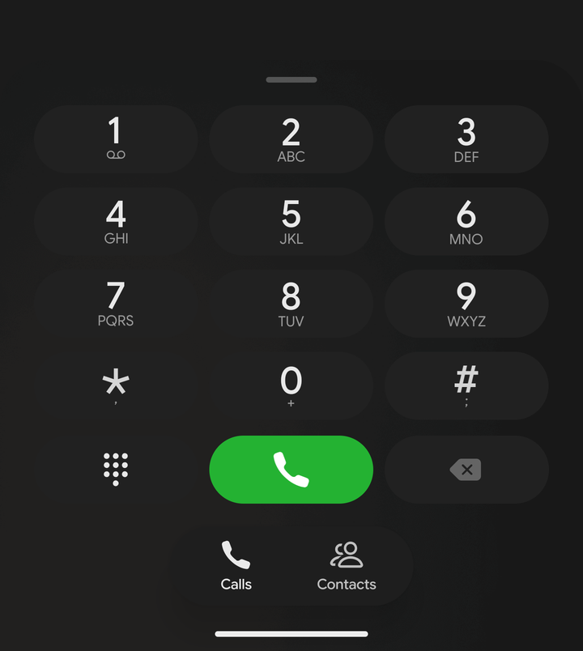
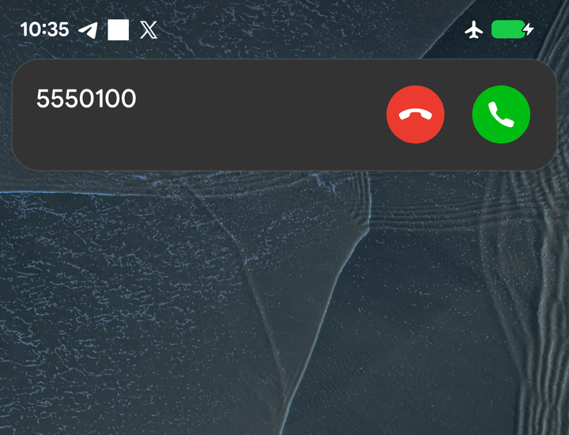
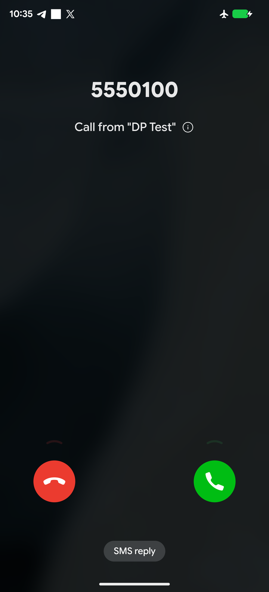
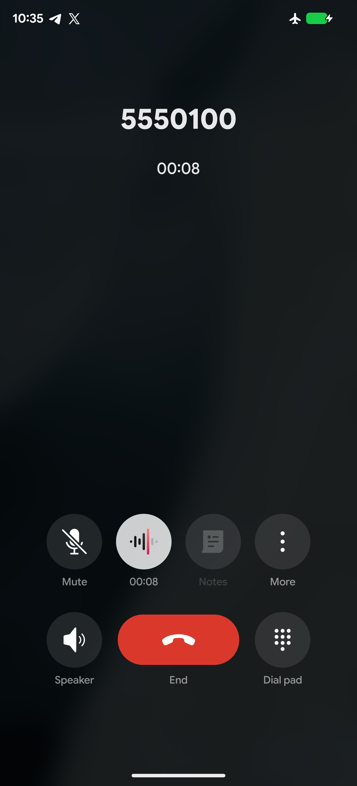

<h1 align="center">Dialer Port</h1>

<b>ColorOS 17 Phone, Contacts, in-call screen and call recording for your OnePlus</b> 
by <b>1tordroid (Tordroid Universal Labs)</b> · Current version: <b>0.1.0-beta.24.2</b>

<a href="https://github.com/1tordroid/dialer-port-releases/releases/latest"><b>⬇ Download (latest release)</b></a> ·
<a href="https://tordroid.com/dialer-port/">Website</a> ·
<a href="https://t.me/Dialer_Port">Telegram</a>

Dialer Port is a root module (KernelSU / KernelSU-Next / SukiSU / APatch / Magisk) that brings the ColorOS 17 Phone, Contacts, in-call screen and call recording to your phone and sets itself as the default Phone app.

## Screenshots

| Dial pad | Incoming (unlocked) | Incoming (locked) | In call + recording |
|---|---|---|---|
|  |  |  |  |

Screenshots use a test call (555 number); no real contacts or call history are shown.

## Device / ROM status

- **Fully tested: DerpFest 17 (OnePlus 12) ✅** — tested in practice, daily use.
- **Support added for crDroid, LineageOS and YAAP — community testers welcome!** (supported in theory, not yet confirmed by testers)
- **Other devices are not blocked**, but the installer shows a red **UNSTABLE** warning first. Expect problems; testers only.
  - Cancel: press **Volume Up** or wait 20 seconds — nothing changes.
  - Continue anyway: **hold Volume Down for 3 seconds** before the countdown ends.

## Major fixes

- Hold and resume no longer drops the call
- Incoming call screen with Answer / Decline shows when the phone is unlocked
- Ongoing call notification stays — tap it to return to the call
- Lock-screen incoming calls wake the screen promptly, no black flash
- Your stock dialer comes back automatically if Dialer Port is disabled or removed
- More reliable uninstall

## Install

1. Download `op12-oplus-dialer-coloros17-in-ksu.zip` from the [latest release](https://github.com/1tordroid/dialer-port-releases/releases/latest) and check its SHA-256 against `SHA256SUMS.txt`.
2. Flash it in your root manager (not in recovery), then reboot.
3. **First setup needs internet once.** Until then your current Phone app keeps working. When the module says "Activated — reboot once", reboot again.
4. Dialer Port then becomes the default Phone app automatically (Settings → Apps → Default apps → Phone).
5. KernelSU-Next + NoMount users: don't isolate / Umount Contacts, InCallUI, Call Recorder, BlackList, Phone, SystemUI or system.

After activation it works offline; connect to the internet at least once a month to stay active.

## Safety (what you need to know)

- **Boot-loop guard:** if the phone fails to boot 2–3 times in a row, the module turns itself off.
- **Safe mode:** KernelSU / KernelSU-Next: press Volume Down 3 times at the boot logo. Magisk: use its volume-key safe mode. Then remove Dialer Port in the manager.
- **Your Phone app is always restored** when the module is disabled or removed. If not, enable it manually: Settings → Apps → Phone → Enable, then set it as default.
- Flash only the official zip from this page. Don't edit, rename or repack it.

## Google Play Protect

Some phones show a Play Protect warning. If it appears, choose **Install anyway** (or More details → Install anyway). If it keeps blocking, turn off **Scan apps with Play Protect**: Play Store → profile picture → Play Protect → Settings (gear) → switch it off (choose **Turn off**, not Pause). You can turn it back on any time. Still stuck? Send your log on Telegram.

## Uninstall

1. In your root manager tap **Remove** on Dialer Port, then reboot. Your stock dialer is re-enabled and set as default.
2. If that is not enough, flash `op12-oplus-dialer-coloros17-in-ksu-uninstaller.zip` (also in the release) in your root manager and reboot.
3. If your default dialer is still missing: Settings → Apps → Phone → Enable, then set it as default.

## Known limits

- VoLTE / HD calling depends on your carrier and network.
- Call Notes and AI call summary are not supported.
- "Add call" on the lock screen asks you to unlock — normal Android behaviour.
- On ROMs without the oplus framework, hold or recording may not work.
- A recovery-flashable installer is not available yet; use your root manager.

## Logs and support

Logs go only to Telegram: **https://t.me/Dialer_Port**. Use the module's **Action** button (or WebUI) → share the redacted log and your anonymous install ID (`DP-XXXX-XXXX`). Nothing is sent automatically.

## Testers wanted: Docalto

Also from Tordroid: **Docalto**, an on-device PDF app. Testers are welcome — see https://docalto.tordroid.com/ and say hi on Telegram.

---
Website: https://tordroid.com/dialer-port/ · Telegram: https://t.me/Dialer_Port · © 1tordroid (Tordroid Universal Labs)
